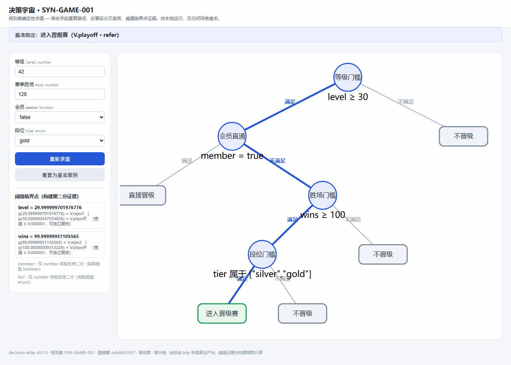
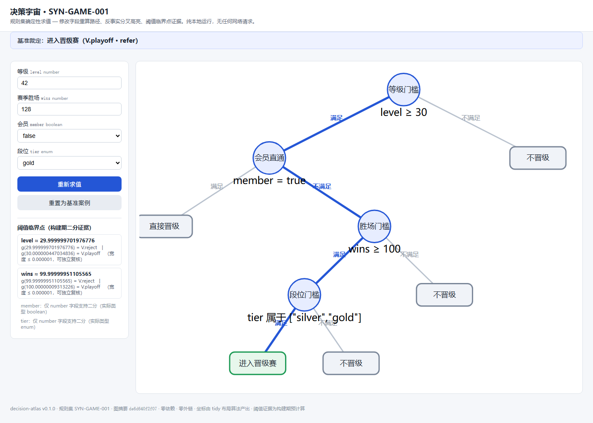
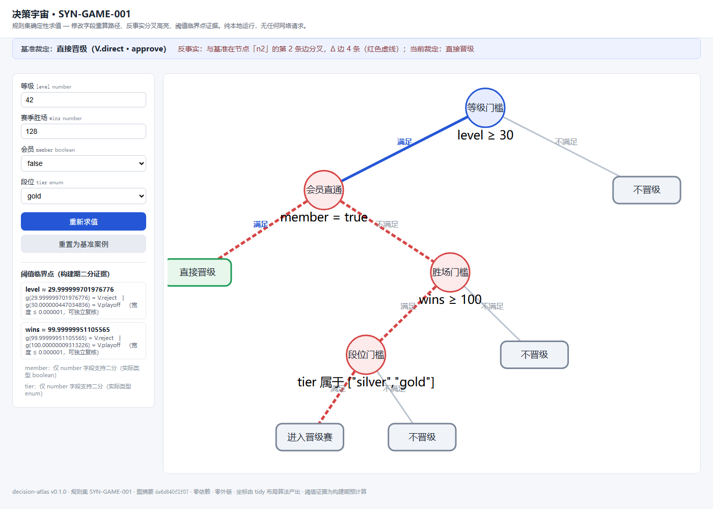
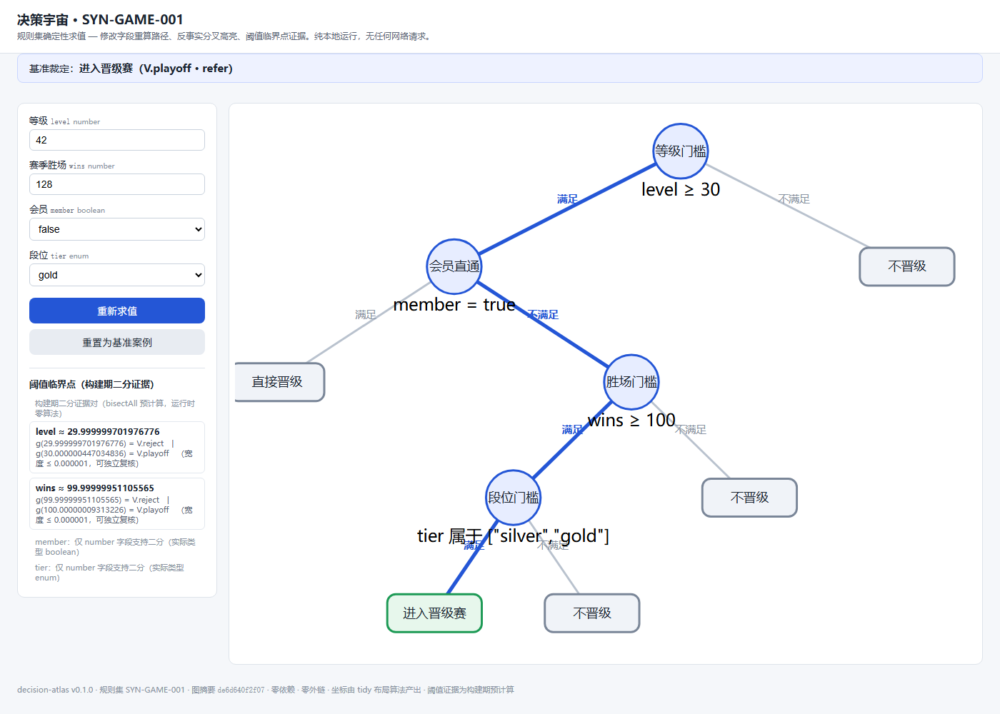
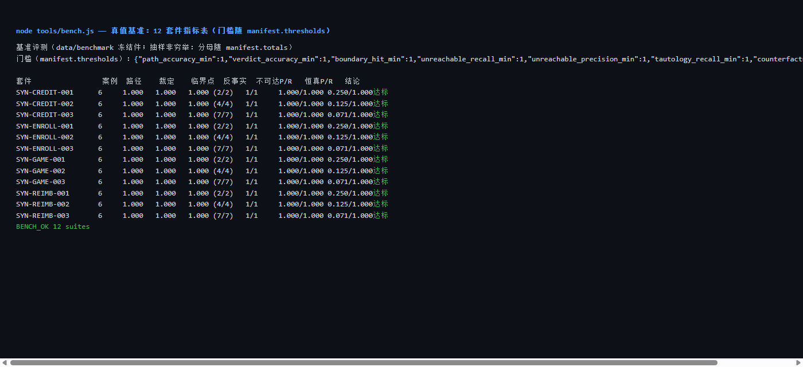

# decision-atlas

**规则集 → 确定性求值 → 可交互单文件 HTML 决策树**（反事实路径差 · 阈值二分 · 零依赖）。

把一份 eligibility／风控／政策规则集（JSON/YAML）编译成**可点击走通、可反事实对比、可自动校验**的单文件 HTML 决策树——每个输出节点由规则引擎**确定性求值**，不是模型"画个大概"。**做会算的图，不是好看的图。**



> 状态：**v0.1.0 已发布**（M0 计划先行、M1 数据先行、M2 确定性内核、M3 渲染、M4 校验与基准、M5 SKILL/报告/素材、M6 GitHub 公开发布——tag v0.1.0 + Release + 发布留档，项目完结）。

## 与"AI 画图"的本质区别

| 渲染语义（通用图表工具） | **求值语义（本项目）** |
|---|---|
| 能画出决策树的形状 | 每条边、每个裁定由规则引擎**逐条布尔求值** |
| 布局确定性 | **求值确定性**：同输入重复运行字节级一致（sha256 断言） |
| 无反事实 | **反事实路径差**：高亮分叉边集合 == `path(A) Δ path(A')`（可断言） |
| 无临界点 | **阈值二分**：临界值 v* 满足 `eval(v*) ≠ eval(v*+ε)`（可证伪，证据对自足） |
| 产物难校验 | 内嵌 `__DECISION_GRAPH__` 等 JSON 按 schema 断言 + 覆盖率自检 + 重渲染逐字节比对 |

**坐标由算法算**（tidy-tree 系布局），**模型永不产出坐标、永不产出裁定**；纯本地处理，规则集不上传、零网络请求、单文件 HTML 无 CDN 无外部资源。

## 演示截图

| 走通高亮 | 反事实 Δ（红色虚线 = `path(A) Δ path(A')`） | 阈值临界点面板 |
|---|---|---|
|  |  |  |

| `node tools/bench.js` 指标表 | `node tools/validate.js --check` 产物校验 |
|---|---|
|  |  |

## 快速开始（零依赖：无需 `npm install`，只需 Node ≥ 20）

```bash
node tools/atlas.js selftest          # 内置自检（确定性双跑 + 渲染双跑 + 无外链）
node tools/atlas.js build data/samples/demo-game.rules.json --case data/samples/demo-game.case.json -o out/demo-game.html
# 然后用浏览器直接打开 out/demo-game.html（file:// 即可，离线可交互）
node tools/atlas.js walk data/samples/demo-game.rules.json --case data/samples/demo-game.case.json   # 查看求值 trace
node tools/atlas.js bisect data/samples/demo-game.rules.json --case data/samples/demo-game.case.json # 阈值二分（临界点证据对）
node tools/validate.js data/samples/demo-game.rules.json out/demo-game.html --check  # 产物校验（不变量 + 重渲染逐字节比对）
node tools/bench.js                   # 真值基准：一条命令出指标表（data/benchmark 冻结件）
npm test                              # 运行测试套件（node:test，零第三方依赖）
```

以上命令在干净目录逐条实测一次跑通（记录见 `plan/06-里程碑详表.md` M5 节）。退出码约定（全部工具统一）：`0` 成功 / `1` 内容校验失败 / `2` 用法或输入形态不可用。

完整操作说明（输入契约 / 错误码表 / 边界 / 自定义指引）见 **[SKILL.md](SKILL.md)**；技术原理见 **[docs/report.md](docs/report.md)**。

## 基准指标（M4 末态，`node tools/bench.js` 实测回填）

门槛随 `data/benchmark/manifest.json` 的 `thresholds` 节下发（全指标下限 1.0）。12 套件（4 白名单场景 × 3 档）末态实测：

| 指标 | 实测 | 说明 |
|---|---|---|
| 路径准确率 | 1.000（72/72 案例） | expect 键（node:*/edge:*）全命中案例占比 |
| 裁定准确率 | 1.000（72/72） | verdict:* 命中占比 |
| 临界点命中率 | 1.000（52/52 真值） | 裁定级 12 条 bisect 证据对复核 + path 级 12 条 + prefix_implied 28 条如实登记 |
| 不可达检出 | precision 1.000 / recall 1.000（12 条植入） | coverage 抽象解释 vs 约束影子植入集合；模板外恒真额外检出如实登记不折算 |
| 恒真检出 | recall 1.000（12 条 n5 prefix_implied） | precision 不设门槛（nB*/n6 结构性恒真是模板事实，FP 如实展示） |
| 反事实 Δ 对账 | 12/12 集合等式 | delta:edge:* 期望 == diffPaths 实测（双向包含） |
| 探活必红 | 48/48（4 缺陷 × 12 套件全 exit 1） | 篡改期望 / 坏引用规则集 / 边界挪动 ε 外 / 不可达注入 |

抽样非穷举声明：分母 = 12 规则包 / 112 节点 / 72 案例（`manifest.totals`）。

## 仓库结构

```
SKILL.md   Agent 操作入口（何时用 / 输入契约 / 命令 / 边界 / 自定义指引）
src/       规则引擎、schema 校验、布局、渲染（确定性内核，零第三方依赖）
tools/     atlas.js CLI（selftest/build/walk/bisect/counterfactual）+ validate.js + bench.js + gen_bench.js
data/      数据台账与合成样例（白名单假业务场景；基准冻结件 data/benchmark）
tests/     node:test 测试套件（84 项）
docs/      report.md 技术报告 + demo/ 演示素材（截图/GIF，程序化产出、双跑 sha256 一致）
plan/      项目计划（00–07 + 交接快照 HANDOFF-M*.md）
```

## 路线图

| 里程碑 | 内容 | 状态 |
|---|---|---|
| M0 | 计划先行 + 可运行骨架 | ✅ |
| M1 | schema v1 冻结 + 合成基准数据（植入真值） | ✅ |
| M2 | 确定性内核（引擎 + 反事实 Δ + 阈值二分 + YAML 子集） | ✅ |
| M3 | 单文件 HTML 渲染完成（tidy 布局 + 交互） | ✅ |
| M4 | 校验器 + 覆盖率自检 + 真值基准 | ✅ |
| M5 | SKILL.md + 技术报告 + README 正式版 + 演示素材 | ✅ |
| M6 | GitHub 公开发布 + Release | ✅ 2026-10-15（[v0.1.0 Release](https://github.com/yuluo554/decision-atlas/releases/tag/v0.1.0)） |

## 限制

- **编译器/可视化器，不是规则引擎生成器**：规则集由用户提供，本工具不做规则创作/补全/改写；裁定 = 规则集的机械求值结果（工程可证伪承诺，不构成业务/合规/医疗意见）。
- **覆盖率为诚实保守口径**：复合条件（all/any）的否定分支与数域 `==`/`!=` 的挖点不细化，证明不了的一律显式标 `unknown`，不折算成命中。
- **阈值二分仅 number 字段**，且要求声明 `search_range`（缺失则如实 skip，不猜范围）；不做单调性假设，多转折逐一如实报告。
- **YAML 为文档化子集**（块映射/序列、标量、单行内联流）；锚点/别名/多文档/多行标量等越界语法显式报错（exit 2），绝不猜测。
- **基准为合成虚构场景**（白名单 `SYN-*`，与任何真实机构无关）：证明的是"指标可对账、缺陷必报红"，不是真实业务准确率。
- 交互在浏览器内完成但**运行时零算法**：阈值证据对构建期预计算，页面只做展示与高亮消费。

## 许可

[MIT](LICENSE) © 2026 yuluo554
